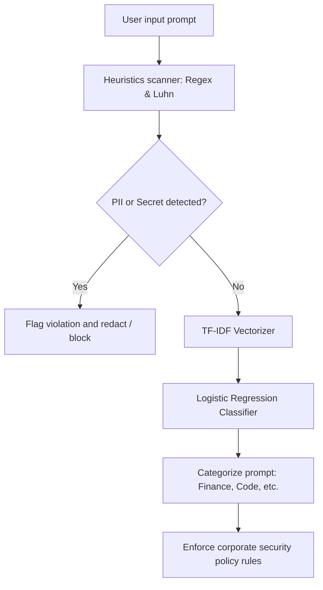
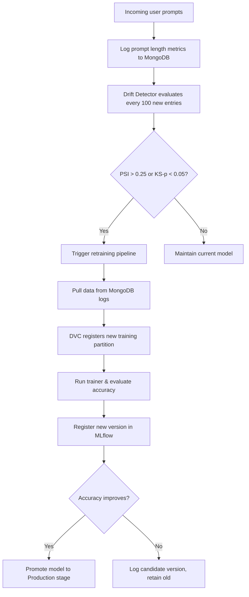

# SecurePrompt AI - MLOps & DevOps Platform Reference Architecture Guide

This document provides a single-source-of-truth reference for the **SecurePrompt AI** MLOps middleware platform. It covers our technology stack, ML models, dataset versioning, drift detection parameters, auto-retraining pipelines, container orchestration, and telemetry dashboards.

---

## 🛠️ 1. Platform Technology Stack

Our platform combines high-throughput API services, real-time regex/NER scanners, machine learning classification, and containerized telemetry.

| Category | Technology | Tool | Purpose |
| :--- | :--- | :--- | :--- |
| **API Backend** | Python 3.11 | **FastAPI** & **Uvicorn** | High-performance async server for browser extension checks. |
| **Database** | NoSQL | **MongoDB** | Stores audit logs, feedback logs, and metadata for retraining. |
| **Telemetry** | Scraper | **Prometheus** | Scrapes real-time request latencies, threat counts, and hardware usage. |
| **Visualization** | Dashboards | **Grafana** | Visualizes security trends, system resource health, and drift indexes. |
| **MLOps** | Tracking & Registry | **MLflow** | Tracks training parameters, losses, and registers production model assets. |
| **Data Versioning**| Hash Registry | **DVC** (Data Version Control) | Tracks dataset files on local cache disk and tags data changes. |
| **Gateway Proxy** | Reverse Proxy | **NGINX** | Handles rate limiting (10 req/s), gzip compression, SSL, and routing. |
| **Containerization**| Containers | **Docker** & **Docker Compose** | Bundles all components into isolated, portable services. |
| **CI/CD** | Automation | **GitHub Actions** | Evaluates code syntax, runs test suites, and compiles Docker images. |

---

## 🧠 2. Machine Learning & Interception Models

SecurePrompt AI uses a hybrid interception strategy: a lightweight heuristics engine coupled with a machine learning classification pipeline.



### A. Heuristics Scanner (PII & Secrets)
* **Code Location**: [backend/app/ml/scanner.py](file:///d:/SecurePrompt%20AI/backend/app/ml/scanner.py)
* **Technology**: SpaCy (Named Entity Recognition) + Regex Patterns + Luhn Checksum.
* **Matched Signatures**:
  * *PII*: Emails, Phone Numbers, SSNs, IP Addresses.
  * *Credentials*: AWS Access Keys, GitHub PATs, Stripe Secret Keys, Slack Webhook URLs, Private SSH Keys.
  * *Financials*: Credit Cards (validated dynamically via Luhn's algorithm).

### B. Machine Learning Content Classifier
* **Code Location**: [engine/trainer.py](file:///d:/SecurePrompt%20AI/engine/trainer.py) (training) and [backend/app/ml/classifier.py](file:///d:/SecurePrompt%20AI/backend/app/ml/classifier.py) (serving).
* **Algorithm**: **TF-IDF Vectorizer** (transforms text into numerical TF-IDF feature vectors) + **Logistic Regression** (predicts category probabilities).
* **Model Weights (Serialized)**:
  * Vectorizer weights: `model/vectorizer.pkl`
  * Classifier weights: `model/classifier.pkl`
* **Categories Predicted**:
  * `Finance & Accounting`
  * `Healthcare & Medical`
  * `Source Code & Engineering`
  * `Public & Safe`
  * `Uncategorized / Other`

### C. Dynamic Model Sync (Model Registry)
* **Code Location**: [engine/ml_detector.py](file:///d:/SecurePrompt%20AI/engine/ml_detector.py)
* **Integration**: When `MLFLOW_MODEL_SYNC=true` is enabled, the backend bypasses the local `.pkl` files and queries the **MLflow Model Registry** for the model tagged in the `Production` stage, downloading and hot-swapping the active classifier model in memory.

---

## 💾 3. Dataset Architecture & DVC Registry

ML model training datasets and telemetry logs are separated into baseline training sets and operational feedback databases.

### A. Dataset File Locations
* **Baseline Dataset**: Stored locally during development as CSV files:
  * Raw prompts and target category files are versioned by DVC.
  * Description file: `data.dvc` (contains MD5 file hashes mapping to local `.dvc/cache`).
* **Retraining Datasets**: Compiled dynamically inside [engine/retrain_pipeline.py](file:///d:/SecurePrompt%20AI/engine/retrain_pipeline.py) by querying the MongoDB `scans` and `accuracy_feedback` collections.

### B. DVC Manager Engine
* **Code Location**: [engine/dvc_manager.py](file:///d:/SecurePrompt%20AI/engine/dvc_manager.py)
* **Mechanism**: Wrapper running DVC commands. It adds datasets using `dvc add`, creates MD5 file-descriptor files, and updates git pointers to track database changes in version control.

---

## 📈 4. Drift Detection & Retraining Engine

Data distribution drift triggers model degradation. We calculate metric deviations on client prompts in real-time.



### A. Drift Detection Engine
* **Code Location**: [engine/drift_detector.py](file:///d:/SecurePrompt%20AI/engine/drift_detector.py)
* **Metrics Audited**: Prompt length distributions.
* **Mathematical Operations**:
  1. **Population Stability Index (PSI)**: Uses baseline data to establish quantile boundaries (extended to `[-np.inf, np.inf]` to capture outlier target data). A PSI score of $\ge 0.25$ signals **significant data drift**.
  2. **Kolmogorov-Smirnov Test (KS-Test)**: Compares baseline and target continuous distributions. A p-value of $< 0.05$ signals that the target distribution deviates significantly.

### B. Auto-Retraining Pipeline
* **Code Location**: [engine/retrain_pipeline.py](file:///d:/SecurePrompt%20AI/engine/retrain_pipeline.py)
* **Trigger Endpoint**: `/api/mlops/retrain` (polls active MongoDB logs, updates training DVC files, trains the logistic regression model, evaluates performance, registers the candidate in MLflow, and automatically promotes it to `Production` if validation checks pass).

---

## 📊 5. Metrics Telemetry (Prometheus & Grafana)

The FastAPI server is monitored via standard Prometheus client scrapers and visual panels.

### A. Telemetry Metrics Collected
* **Request Telemetry**:
  * `http_requests_total`: Counter tracking total queries by endpoint and HTTP status code.
  * `http_request_duration_seconds`: Histogram tracking request processing latencies.
* **Security Telemetry**:
  * `secureprompt_scans_total`: Counter tracking scans by category and severity.
  * `secureprompt_actions_total`: Counter tracking actions taken (`ALLOW`, `WARN`, `BLOCK`).
  * `secureprompt_drift_psi`: Gauge recording the latest PSI drift index.
* **System Hardware**:
  * `secureprompt_cpu_usage_percent` & `secureprompt_memory_usage_bytes`: Track hardware resource loads.

### B. Visual Dashboards
* **Configuration Files**:
  * Prometheus targets: [prometheus.yml](file:///d:/SecurePrompt%20AI/prometheus/prometheus.yml)
  * Grafana provision dashboard: [secureprompt_dashboard.json](file:///d:/SecurePrompt%20AI/grafana/dashboards/secureprompt_dashboard.json)
* **Grafana Visual Panels**:
  * tail latencies (50th, 90th, 99th percentiles).
  * Allowed vs Blocked vs Warned distribution ratios.
  * Active server hardware consumption.
  * Real-time Data Drift alerts.

---

## 🏃 6. Running and Testing the Platform

### A. Option 1: Docker Compose Stack (Easiest)
Launches the entire database, backend API, MLflow, Prometheus, Grafana, and NGINX stack:
```bash
docker compose up --build -d
```

### B. Option 2: Running Locally (Manual Dev Mode)
1. **Create and Activate virtual environment**:
   ```bash
   python -m venv venv
   .\venv\Scripts\Activate.ps1   # Windows
   ```
2. **Install requirements**:
   ```bash
   pip install -r backend/requirements.txt
   pip install -r engine/requirements.txt
   python -m spacy download en_core_web_sm
   ```
3. **Start the MLflow Tracking Server**:
   ```bash
   mlflow server --backend-store-uri sqlite:///mlflow.db --default-artifact-root ./mlruns --port 5000
   ```
4. **Train the baseline classification model**:
   ```bash
   python -m engine.trainer
   ```
5. **Start the FastAPI Backend**:
   ```bash
   python -m uvicorn app.main:app --app-dir backend --host 127.0.0.1 --port 8000 --reload
   ```

### C. Run the Test Suites
Validate platform math, APIs, and client extensions:
```bash
# Run unit checks (PII matching, Luhn, PSI math)
python -m unittest tests/test_unit.py

# Run mock extension client schema checks
python -m unittest tests/test_extension.py

# Run server API routing tests
python -m unittest tests/test_api.py

# Run concurrency load test (Simulates 10 clients for 5s)
python tests/load_test.py --url http://127.0.0.1:8000 --concurrency 10 --duration 5
```
