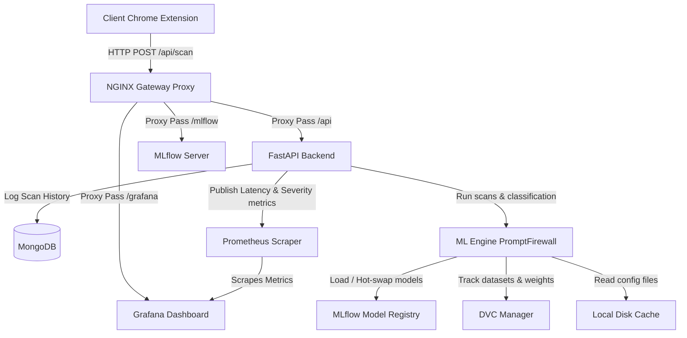

# SecurePrompt AI - Comprehensive Project Architecture & ML Reference Guide

This document provides an in-depth reference for **SecurePrompt AI**, a real-time middleware platform designed to intercept, analyze, sanitize, and control corporate prompts before they are submitted to LLM provider gateways (e.g., OpenAI, Gemini, Groq). 

It details our **modular multi-engine architecture**, **machine learning models**, **mathematical validation algorithms**, **data storage schemas**, and the automated **MLOps lifecycle** (drift detection, DVC version control, MLflow registry syncing, and hot-swapping).

---

## 🗺️ 1. High-Level Architecture Overview

SecurePrompt AI uses a hybrid interception strategy: a lightweight heuristics engine coupled with a machine learning classification pipeline.

The entire enterprise firewall works across a containerized stack, integrating telemetry logging, ML model deployment, database persistence, and a Chrome client extension.



### Component Stack
| Layer / Component | Technology | Primary Role |
| :--- | :--- | :--- |
| **Client Frontend** | Chrome Extension API (v3) | Intercepts textarea inputs on popular AI websites (ChatGPT, Claude, Gemini), performs real-time scans, alerts users, blocks submissions, or sanitizes PII. |
| **API Gateway** | NGINX | Handles SSL/TLS, reverse-proxy routing, gzip compression, and rate limiting (capped at 10 requests/second per client IP). |
| **Backend Server** | FastAPI / Uvicorn (Python 3.11) | High-performance asynchronous API parsing requests, managing MongoDB logs, serving metrics, and invoking the ML engine. |
| **Database** | MongoDB (NoSQL) | Retains records of scans, user-labeling accuracy feedback, active security configurations, and historical threat alerts. |
| **Model Registry** | MLflow | Tracks model runs, loss/accuracy curves, metrics, and manages the lifecycle registry (`Staging`, `Production`, `Archived`). |
| **Data Versioning** | DVC (Data Version Control) | Tracks raw and retrained CSV datasets and model weights locally, generating MD5 hashes committed to Git to prevent repository bloat. |
| **Telemetry & Alerts** | Prometheus & Grafana | Prometheus scrapes server statistics, risk frequencies, and hardware utilization. Grafana displays real-time security dashboards and drift alarms. |

---

## ⚡ 2. The 6-Module Security Scan & Decision Pipeline

When a prompt is scanned via `POST /api/scan`, the backend instantiates [PromptFirewall](file:///d:/SecurePrompt%20AI/engine/firewall.py), which pipes the input text through **six isolated assessment modules** to calculate a multi-vector risk score.

```text
Incoming Prompt 
      │
      ├──► Module 1: Heuristic PII & Secrets Scanner (spaCy NER, Regex Patterns)
      │
      ├──► Module 2: Source Code Footprint Detector (14 languages + hardcoded credentials)
      │
      ├──► Module 3: Document Similarity Engine (SentenceTransformers / TF-IDF Vectorizer)
      │
      ├──► Module 4: 9-Class Content Classifier (Logistic Regression / DistilBERT NLP)
      │
      ├──► Module 5: Risk Scoring Matrix (Weights category, policy, department, history)
      │
      └──► Module 6: Sanitization & Action (ALLOW, WARN, SANITIZE, BLOCK)
```

---

## 🧠 3. Machine Learning Models & Frameworks

SecurePrompt AI operates on a hybrid architecture combining rule-based heuristics, classical machine learning, and deep learning transformers.

### A. Heuristics & Named Entity Recognition (NER)
* **Code Implementation**: [ner_detector.py](file:///d:/SecurePrompt%20AI/engine/ner_detector.py) and [regex_detector.py](file:///d:/SecurePrompt%20AI/engine/regex_detector.py)
* **Technologies**: 
  * **spaCy (`en_core_web_sm` model)**: Extracts linguistic entities. Standard tags are converted to PII definitions:
    * `PERSON` ──► `NAME` (Severity: MEDIUM, confidence boosted to 95% if preceded by intro contexts like *"my name is"*, *"call me"*).
    * `ORG` ──► `ORGANIZATION` (Severity: LOW).
    * `GPE` ──► `LOCATION` (Severity: LOW).
    * `DATE` ──► `DATE` (Severity: LOW).
  * **Regular Expressions (Regex)**: Compiles 44 compiled regex patterns auditing for Emails, Phone Numbers, JWTs, Passwords, API tokens (AWS, OpenAI, Gemini, GitHub, Groq, Azure, Stripe), SSH Private Keys, DB connection strings, and Credit Card signatures.

### B. Machine Learning Content Classifier
* **Code Implementation**: [prompt_classifier.py](file:///d:/SecurePrompt%20AI/engine/prompt_classifier.py)
* **Algorithm**: **TF-IDF Vectorizer** (unigram/bigram token ranges, capped at 1,200 features) + **Logistic Regression** (regularized with C=2.0).
* **Target Categories**: Classifies prompts into 9 functional corporate categories:
  * `General` (Risk Level: LOW)
  * `Programming` (Risk Level: LOW)
  * `Finance` (Risk Level: MEDIUM)
  * `HR` (Risk Level: MEDIUM)
  * `Internal Document` (Risk Level: MEDIUM)
  * `Legal` (Risk Level: HIGH)
  * `Customer Data` (Risk Level: HIGH)
  * `Healthcare` (Risk Level: HIGH)
  * `Security` (Risk Level: CRITICAL)

### C. Deep Learning Transformer (Alternative serving model)
* **Code Implementation**: [trainer.py](file:///d:/SecurePrompt%20AI/engine/trainer.py) (HuggingFace Trainer)
* **Model**: **DistilBERT** (`distilbert-base-uncased` sequence classification).
* **Serving**: Used when GPU environments are detected and `TRAIN_DEEP_LEARNING=true` is enabled. It classifies prompt texts into binary classes (`SENSITIVE` vs. `SAFE`) with higher accuracy on complex semantics.

---

## 🧮 4. Key Mathematical Algorithms Used

### A. Mathematical Checksum Validators
To prevent high false-positive rates inherent in regex matching, candidate strings are validated via mathematical checksums before triggering alerts:
1. **Luhn Algorithm (Credit Cards)**:
   $$\text{Checksum} \equiv \sum_{i=1}^{n} d_i \pmod{10} = 0$$
   Doubles every second digit starting from the right. If doubling exceeds 9, subtracts 9.
2. **Verhoeff Algorithm (Aadhaar Numbers)**:
   Uses dihedral group $D_5$ multiplication tables and permutation matrices to validate the checksum of Indian national IDs.
3. **IBAN Validation**:
   Converts country codes to integers, performs a modulo 97 operation, and asserts the remainder is equal to 1.

### B. Document Cosine Similarity
* **Code Implementation**: [document_similarity.py](file:///d:/SecurePrompt%20AI/engine/document_similarity.py)
* **Vector DB Mode**: Extracts text from files (PDF, DOCX, CSV, Excel, TXT) and computes embeddings via **SentenceTransformers (`all-MiniLM-L6-v2`)**. Saves vectors inside a persistent **ChromaDB** index and queries similarity via L2/Cosine distance.
* **Fallback TF-IDF Mode**: If ChromaDB/PyTorch is unavailable, fits a TF-IDF vectorizer over local indexed files (`fallback_docs.csv`) and computes Cosine Similarity against incoming text vectors:
  $$\text{Cosine Similarity}(A, B) = \frac{A \cdot B}{\|A\|\|B\|}$$

### C. Risk Scoring Matrix Engine
* **Code Implementation**: [risk_scoring.py](file:///d:/SecurePrompt%20AI/engine/risk_scoring.py)
* **Algorithm**: Computes a weighted aggregate value $(0\text{--}100)$ based on multi-vector parameters:
  $$\text{Risk Score} = 0.35S + 0.15C + 0.20D + 0.15K + 0.10P + 0.05H$$
  * **$S$ (Sensitive Data Level)**: PII/Secrets presence ($NONE=0$, $LOW=20$, $MEDIUM=50$, $HIGH=80$, $CRITICAL=100$).
  * **$C$ (Source Code Level)**: $40$ for code syntax, upgraded to $95$ if credentials are found inside the code block.
  * **$D$ (Document Similarity Score)**: Normalized percentage of closest corporate policy matches.
  * **$K$ (Prompt Category Score)**: Base category threat (e.g. $Security=90$, $General=5$).
  * **$P$ (Department Policy Alignment)**: Flags anomalous requests depending on user group (e.g., HR sharing code is flagged as $80$, Engineering sharing payroll data is flagged as $60$).
  * **$H$ (Historical Behavior)**: Multiplies risk value based on past violations logged ($0=0$, $1=30$, $2=65$, $3+=100$).

### D. Population Stability Index (PSI) (Data Drift Detection)
* **Code Implementation**: [drift_detector.py](file:///d:/SecurePrompt%20AI/engine/drift_detector.py)
* **Algorithm**: Compares the distribution of continuous features (prompt lengths) in a target dataset (live MongoDB prompts) against the baseline distribution:
  $$\text{PSI} = \sum_{i=1}^{B} (T_i - B_i) \times \ln\left(\frac{T_i}{B_i}\right)$$
  * $T_i$: Target probability distribution fraction in bucket $i$ (with $1e-4$ epsilon smoothing).
  * $B_i$: Baseline probability distribution fraction in bucket $i$ (with $1e-4$ epsilon smoothing).
  * **Threshold**: $\text{PSI} \ge 0.25$ indicates **significant data drift**, automatically triggering retraining.

### E. Kolmogorov-Smirnov Test (KS-Test)
* Evaluates if continuous baseline and target prompt distributions belong to the same population by assessing the maximum vertical distance between their Cumulative Distribution Functions (CDFs):
  $$D = \sup_{x} |F_1(x) - F_2(x)|$$
  * An output p-value $< 0.01$ indicates statistical drift.

---

## 💾 5. Dataset & Model Storage Directory Structure

Data inputs and outputs are versioned, cached, or logged.

```text
SecurePrompt AI/
├── data/
│   ├── hf_compiled_dataset.csv     <── Baseline CSV (Raw training prompts, ~1MB)
│   ├── retrained_dataset.csv       <── Dynamic retraining prompt exports
│   └── retrained_dataset.csv.dvc   <── DVC Hash-pointer mapping dataset changes
│
├── model/
│   ├── best_sklearn/               <── Local folder holding the champion scikit-learn models
│   │   ├── vectorizer.pkl
│   │   └── classifier.pkl
│   ├── distilbert/                 <── Saved local HuggingFace weights and config
│   ├── classifier.pkl              <── Binary classifier active weights (Sklearn Logistic Regression)
│   ├── vectorizer.pkl              <── Feature vectorizer active weights (Sklearn TF-IDF)
│   ├── classifier_9class_cls.pkl   <── Multi-class classifier active weights (Sklearn)
│   ├── classifier_9class_vec.pkl   <── Multi-class vectorizer active weights (Sklearn)
│   ├── fallback_docs.csv           <── TF-IDF Cosine Similarity indexed company policies
│   ├── classifier.pkl.dvc          <── DVC version hash for classifier binaries
│   └── vectorizer.pkl.dvc          <── DVC version hash for vectorizer binaries
│
├── mlruns/                         <── MLflow tracking file system registry directory
├── mlflow.db                       <── SQLite database storing MLflow run history records
└── .dvc/
    ├── config                      <── Local DVC config
    └── local_remote/               <── Sandboxed local Git-bypass dataset directory cache
```

---

## 🔄 6. The Automated MLOps Retraining Loop

SecurePrompt AI features an end-to-end retraining pipeline that closes the loop between user data submissions and production inference updates:

```text
1. User prompt submissions logged in MongoDB
      │
2. Background task monitors length distribution metrics (KS-Test / PSI)
      │
3. Drift detected (PSI >= 0.25) -> Triggers Retraining endpoint /api/mlops/retrain
      │
4. Retraining Pipeline runs:
   ├── Gathers data (retrieves audits from MongoDB, saves to data/retrained_dataset.csv)
   ├── Tracks dataset in Data Version Control (DVC)
   ├── Fits new models (Logistic Regression / DistilBERT)
   └── Validates accuracy and registers run to MLflow Registry
      │
5. Promotion rules check if accuracy matches validation target
      │
6. Promoting model version to "Production" in MLflow Registry
      │
7. FastAPI server hot-swaps active classifier in-memory (MLFLOW_MODEL_SYNC=true)
```

---

## 🔧 7. Running and Testing the Stack

### Pre-requisites & Local Training Setup
1. **Activate the Environment**:
   ```bash
   .\venv\Scripts\Activate.ps1   # Windows
   ```
2. **Train the baseline classification models**:
   ```bash
   python -m engine.trainer
   ```
   This fits the TF-IDF and Logistic Regression classifiers, writes their metrics to `mlflow.db`, tracks them with DVC, and registers them in the local directory structure.

### Launching the Stack via Docker Compose
To launch NGINX, Grafana, Prometheus, MLflow, MongoDB, and the FastAPI backend:
```bash
docker compose up --build -d
```

### Running Test Checklists
Verify the system mathematical operations and API routers:
```bash
# Run unit tests (PSI formula checks, Luhn checksums, scanner scoring rules)
python -m unittest tests/test_unit.py

# Run API endpoint integration tests
python -m unittest tests/test_api.py

# Run Chrome extension API mock payload tests
python -m unittest tests/test_extension.py

# Concurrency load checks (Spams 10 clients for 5 seconds to analyze latency percentiles)
python tests/load_test.py --url http://127.0.0.1:8000 --concurrency 10 --duration 5
```
