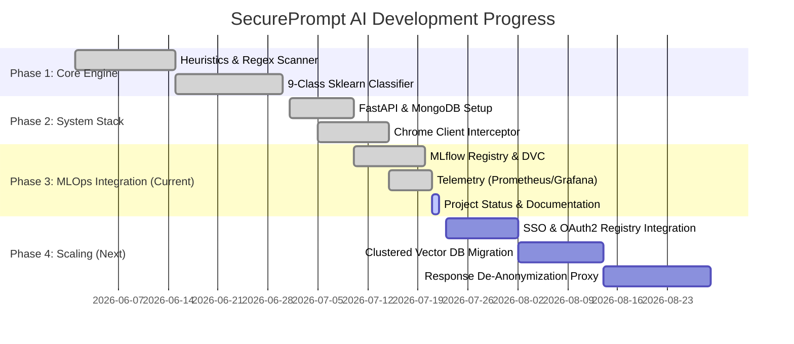

# SecurePrompt AI - Project Status & Future Roadmap

This document outlines the current engineering stage of the **SecurePrompt AI** platform and details the planned future work for scaling it to a robust, enterprise-grade production environment.

---

## 📊 1. Current Project Stage: MVP / MLOps Pilot

SecurePrompt AI is currently in the **MLOps Pilot / Production-Ready MVP** stage. The core infrastructure, API servers, client extensions, model registry, telemetry containers, and drift detection automation are fully implemented and passing validation checks.

### Completed Features Checklist

- [x] **Chrome Client Interceptor**: Real-time textarea hook supporting ChatGPT, Gemini, Claude, Copilot, Grok, Perplexity, DeepSeek, and OpenRouter.
- [x] **PromptFirewall Logic**: Asynchronous multi-engine orchestrator executing 6 pipeline modules in sequence (Heuristic, Code, Similarity, NLP Category, Risk Matrix, Sanitizer).
- [x] **Source Code Footprint Detector**: Matches syntax structures for 14 programming languages and flags hardcoded credentials in code lines.
- [x] **Document Similarity Engine**: Vector search against company documents using local file caches and Cosine Similarity/ChromaDB.
- [x] **Auto-Drift Detection**: Automatic computation of Kolmogorov-Smirnov statistical tests and Population Stability Index (PSI) values on incoming prompt lengths.
- [x] **Automated Retraining Loop**: MongoDB webhook queries, retraining execution pipelines, DVC dataset tracking, MLflow runs registration, and model hot-swapping.
- [x] **Dockerized Stack Orchestration**: Standardized NGINX proxy, MongoDB, MLflow server, Prometheus metric scraping, and Grafana dashboard deployments.
- [x] **Verification Suite**: Integrated load tests and unit tests evaluating API endpoints and math parameters.

---

## 🛠️ 2. Current Implementation Assessment

Below is a breakdown of how the current systems perform and their current limitations:

| System / Component | Current Implementation | Production Limitation | Risk Rating |
| :--- | :--- | :--- | :---: |
| **Named Entity Recognition (NER)** | General spaCy `en_core_web_sm` model. | Manually maps general tags; lacks customized entity recognition for specialized corporate terminology (e.g. project codenames). | **Medium** |
| **Similarity Checks** | Local ChromaDB container or TF-IDF cosine fallback. | Poor horizontal scaling; loading large document sets causes severe memory pressure on the backend container. | **High** |
| **User Identities** | Anonymous Chrome Extension / Hardcoded departments. | Lacks link between Chrome prompts and real-time Active Directory or Single Sign-On identities. | **High** |
| **Sanitized Prompts** | Placeholders sent to LLM providers; response stays redacted. | The user sees placeholders in the LLM response instead of their original values, disrupting user experience. | **Low** |
| **Orchestration** | Local Docker Compose stack. | Lacks load balancing, automated failovers, and Kubernetes node scaling rules. | **Medium** |

---

## 🚀 3. Phase 4 Roadmap: Next Steps

To transition SecurePrompt AI into a robust enterprise solution, development will focus on the following key modules:

### 1. SSO & OAuth2 User Auth Integration in Extension
* **Goal**: Require all Chrome client extensions to authenticate users before scanning prompts.
* **Mechanism**:
  * Implement OAuth2/OIDC login flows inside the Chrome Extension `popup.js`.
  * Support Okta, Microsoft Entra ID (Azure AD), and Google Workspace SSO.
  * Inject the `Authorization: Bearer <JWT>` header in every `/api/scan` call.
  * Automatically resolve the user's corporate department and retrieve their historical violations count from MongoDB to compute the Risk Score.

### 2. Clustered Enterprise Vector Database Migration
* **Goal**: Support tens of thousands of sensitive company documents for similarity checks at low latency.
* **Mechanism**:
  * Replace the local ChromaDB/TF-IDF database wrapper in [document_similarity.py](file:///d:/SecurePrompt%20AI/engine/document_similarity.py).
  * Integrate connection wrappers for clustered, managed vector databases (e.g., **Pinecone**, **Qdrant**, or **Milvus**).
  * Enable async vector upserts when new files are uploaded via the admin console.

### 3. Custom Named Entity Recognition (NER) Fine-Tuning
* **Goal**: High-accuracy extraction of domain-specific secrets and custom PII.
* **Mechanism**:
  * Compile a dataset of synthetic secret formats, corporate database schemas, project names, and internal API keys.
  * Fine-tune a custom transformer-based token classifier (e.g. `BERT-base-NER`) using PyTorch and [train_with_hf.py](file:///d:/SecurePrompt%20AI/engine/train_with_hf.py).
  * Register the model in MLflow and transition it to `Production` to replace the default spaCy model.

### 4. Response De-Anonymization (Reverse Sanitization Proxy)
* **Goal**: Restore redacted placeholders in the LLM's response before displaying it to the user.
* **Mechanism**:
  * When a prompt is sanitized, store the `restore_map` (e.g., `{"[EMAIL_1]": "john@corp.com"}`) in the client storage.
  * Intercept the LLM provider's streaming and final HTTP response in the Chrome content scripts.
  * Run reverse substitution using the stored `restore_map` to re-inject the private data:
    > **LLM Response**: "Sure, I have updated the user account for [EMAIL_1]."  
    > **Display to User**: "Sure, I have updated the user account for john@corp.com."

### 5. Kubernetes (K8s) Production Deployment Setup
* **Goal**: Deploy high-availability clusters.
* **Mechanism**:
  * Write Kubernetes deployment manifests (`deployment.yaml`, `service.yaml`, `ingress.yaml`) for backend pods.
  * Configure Horizontal Pod Autoscalers (HPA) to scale backend pods based on CPU utilization and incoming HTTP traffic volume.
  * Set up MongoDB replica sets with persistent volume claims (PVC).

---

> [!TIP]
> **Priority Recommendation**: Start with **SSO Integration** and **Response De-Anonymization** first, as these provide the most immediate enhancement to security logging and user experience in Chrome.

> [!WARNING]
> Ensure that `JWT_SECRET_KEY` in [docker-compose.yml](file:///d:/SecurePrompt%20AI/docker-compose.yml) is updated to a cryptographically secure random value before migrating to staging or production.
